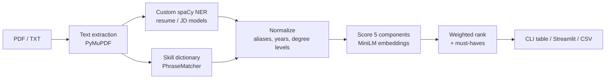

# Resume Ranker

**Rank a stack of resumes against a job description and see *why* each candidate landed where they did.**

Two custom spaCy NER models pull structured facts out of resumes and job descriptions: skills, job titles, years of experience and degrees. A hybrid scorer then compares them by meaning, not exact keywords, so "ReactJS" matches "React" and "3 years 9 months" counts toward "3+ years". Every score comes with its evidence.

```
$ python -m resume_ranker rank samples/jd.txt samples/resumes --must-have kubernetes
  1.  83.8  asha_verma.txt
       missing: backend, celery and message queues, machine learning
  2.  49.1  lena_fischer.txt  DISQUALIFIED (missing kubernetes)
       missing: backend, django, fastapi, postgresql, redis, docker, kubernetes, aws, ci/cd, ...
  3.  40.8  rohan_mehta.txt  DISQUALIFIED (missing kubernetes)
  4.  19.4  tom_baker.txt  DISQUALIFIED (missing kubernetes)
```

## Features

- **Batch ranking**: one job description against a folder of PDF or TXT resumes, from the CLI or a Streamlit app.
- **Explainable scores**: five components, each with evidence ("needs 3.0y, has 5.2y"), plus matched, missing and extra skills per candidate.
- **Semantic matching**: MiniLM sentence embeddings and a skill-alias dictionary instead of exact string comparison.
- **Recruiter controls**: weight sliders re-rank instantly. Must-have skills push candidates who lack them to the bottom, still visible, with the reason shown.
- **CSV export** of the full ranking.
- **Reproducible models**: one command retrains either NER model from the committed training data, on CPU.
- **Evaluation harness**: pooled NDCG@5 / P@5 against the original keyword scorer, with per-component ablations.

## Quickstart

Requires Python 3.11+.

```bash
python -m venv .venv
.venv/Scripts/python -m pip install -r requirements.txt     # Windows
# .venv/bin/python -m pip install -r requirements.txt       # Linux / macOS
```

Activate the venv, then:

```bash
# 1. Get the NER models: train them (CPU, roughly 20–40 min each on a laptop) ...
python -m resume_ranker train jd
python -m resume_ranker train resume
#    ... or download pretrained ones by setting RESUME_RANKER_HF_REPO=<user>/<repo>

# 2. Rank from the command line
python -m resume_ranker rank samples/jd.txt samples/resumes --csv ranking.csv

# 3. Or use the app
streamlit run app.py
```

`samples/` contains a fictional job description and four fictional resumes to try it with.

### CLI reference

```
python -m resume_ranker rank JD RESUME_DIR [--top N] [--csv PATH] [--must-have SKILL ...]
python -m resume_ranker train {resume,jd} [--gpu]
```

Unreadable, empty or unsupported files are skipped with a warning; the rest are still ranked.

## How it works



1. **Extract.** The resume model recognizes 18 entity types and the JD model 5; the ranker uses skills, job titles, experience and degrees. A curated skill dictionary (`resume_ranker/skills.json`) scans both documents too. It catches skills the models miss, such as tools mentioned only inside a job's description.
2. **Normalize.** Skill aliases are collapsed (`ReactJS` → `react`). Per-job durations ("3 years 9 months") are summed into total experience. JD requirements ("3-5 years", "5<10 years", "2+ yrs") are read as their lower bound. Degrees are mapped to levels (diploma < bachelor < master < PhD); a resume uses its highest, a JD its lowest acceptable.
3. **Score.** Five components, each in [0, 1]:

   | Component | Weight | How it's computed |
   |---|---|---|
   | Skills | 0.40 | Each JD skill is matched to the closest resume skill by embedding similarity (cosine ≥ 0.75); score = share of JD skills matched |
   | Experience | 0.20 | Total years ÷ required years, capped at 1 |
   | Role | 0.15 | Best similarity between the candidate's past titles and the JD title |
   | Education | 0.10 | Degree level ÷ required level, capped at 1 |
   | Overall fit | 0.15 | Similarity of the two whole documents |

4. **Rank.** The total is the weighted average on a 0–100 scale. Component scores are computed once and cached, so changing weights or must-haves in the app re-ranks instantly.

### Example explanation

The top candidate from the sample run above:

| Component | Score | Evidence |
|---|---|---|
| Skills | 0.79 | 11/14 required skills |
| Experience | 1.00 | needs 3.0y, has 5.2y |
| Role | 0.73 | 'Senior Backend Engineer' ~ 'Senior Python Backend Engineer' |
| Education | 1.00 | needs bachelor, has bachelor |
| Overall fit | 0.77 | whole-document similarity |

Missing: `backend`, `celery and message queues`, `machine learning`. **Total: 83.8**

## Results

### Ranking quality

The evaluation compares the hybrid scorer with the original notebook's keyword scorer on held-out data. There are 3 job descriptions, each with a pool of 15 resumes, labeled by hand from 0 (irrelevant) to 3 (would interview). The pools combine both systems' top picks with random fill and are shuffled before labeling, so the labeler can't tell which system chose a resume.

```bash
python eval/evaluate.py list           # browse the held-out job descriptions
python eval/evaluate.py pool 0 5 13    # build labeling pools
python eval/evaluate.py score          # NDCG@5 / P@5 table, with per-component ablations
```

*Labeling is in progress. The results table will appear here once it's done.*

### NER quality

The models were retrained on CPU (spaCy tok2vec). The original GPU transformer (roberta-base) models scored F1 0.863 on resumes and 0.583 on job descriptions.

| Model | Precision | Recall | F1 |
|---|---|---|---|
| Resume (18 labels) | 0.784 | 0.769 | **0.776** |
| Job description (5 labels) | 0.521 | 0.503 | **0.512** |

Labels the ranker actually uses:

| Label | Model | F1 |
|---|---|---|
| YEARS OF EXPERIENCE | resume | 0.935 |
| WORKED AS | resume | 0.824 |
| DEGREE | resume | 0.752 |
| SKILLS | resume | 0.693 |
| EXPERIENCE | JD | 0.739 |
| JOBPOST | JD | 0.588 |
| SKILLS | JD | 0.494 |
| DEGREE | JD | 0.349 |

The JD model is the weak link, so the ranker backs it up: the skill dictionary also scans the JD text, and when the model finds no experience requirement, the years are read from any line that mentions "experience".

<details>
<summary>All resume labels</summary>

| Label | P | R | F1 |
|---|---|---|---|
| LINKEDIN LINK | 0.955 | 0.971 | 0.963 |
| YEARS OF EXPERIENCE | 0.894 | 0.979 | 0.935 |
| WORKED AS | 0.807 | 0.842 | 0.824 |
| COMPANIES WORKED AT | 0.848 | 0.791 | 0.818 |
| LOCATION | 0.732 | 0.823 | 0.775 |
| NAME | 0.819 | 0.718 | 0.766 |
| DEGREE | 0.766 | 0.739 | 0.752 |
| UNIVERSITY | 0.794 | 0.653 | 0.717 |
| EMAIL ADDRESS | 0.714 | 0.714 | 0.714 |
| SKILLS | 0.696 | 0.691 | 0.693 |
| LANGUAGE | 0.687 | 0.648 | 0.667 |
| COLLEGE NAME | 0.584 | 0.672 | 0.625 |
| CERTIFICATION | 0.574 | 0.506 | 0.538 |
| AWARDS | 0.558 | 0.358 | 0.436 |
| YEAR OF GRADUATION | 0.000 | 0.000 | 0.000 |

</details>

## What changed from the original notebook

The project started as a Colab notebook (kept in `notebooks/` for reference). That notebook:

- ran only in Colab, with hardcoded Google Drive paths and no committed model weights;
- scored a single resume with exact string matches: +5 per identical skill and +10 per identical degree or job title;
- ignored experience entirely;
- awarded points from a hardcoded list of "good companies".

The company list was dropped as an arbitrary and biased signal. The rest of the notebook's logic is kept as `legacy_score` and serves as the baseline in the evaluation.

## Project layout

| Path | What |
|---|---|
| `resume_ranker/parse.py` | File → text, NER, normalization into `Profile`s |
| `resume_ranker/score.py` | Component scores, evidence, weighted total, legacy baseline |
| `resume_ranker/rank.py` | Ranking under weights and must-haves; CSV rows |
| `resume_ranker/cli.py` | `rank` and `train` commands |
| `resume_ranker/skills.json` | Canonical skills and their aliases |
| `app.py` | Streamlit UI |
| `eval/evaluate.py` | Pooled evaluation |
| `data/` | spaCy training and held-out data for both models |
| `configs/` | `cpu.cfg` (default) and `gpu.cfg` (roberta-base) |
| `samples/` | Fictional demo inputs |
| `tests/` | `python -m pytest` |

**GPU training** (`train --gpu`) needs `spacy-transformers` and CUDA. Use a separate environment, such as Colab: `spacy-transformers` pins older `transformers` / `huggingface_hub` versions that break `sentence-transformers`.

## Limitations

- The training data is mostly LinkedIn-export profiles of tech workers. Other resume layouts and non-tech domains extract worse.
- Overlapping jobs double-count experience.
- Scanned PDFs without a text layer are skipped; there is no OCR.
- MiniLM reads only the first ~256 tokens of each document for the overall-fit score.
- The 0.75 skill-match threshold is strict: "react" vs "reactjs developer" scores 0.73. The alias dictionary covers the common cases exactly.
- 45 labeled pairs are enough to compare scoring systems, not to claim production accuracy.
